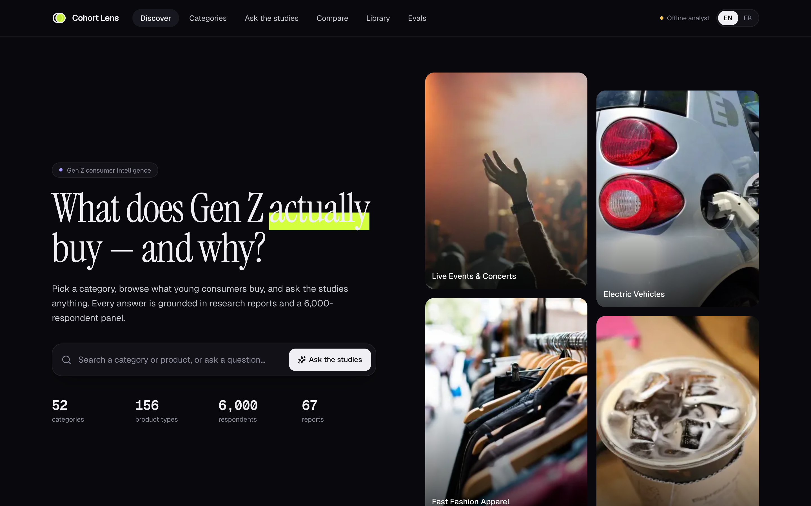
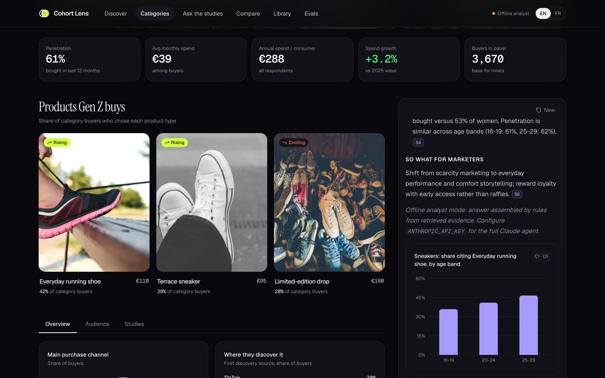
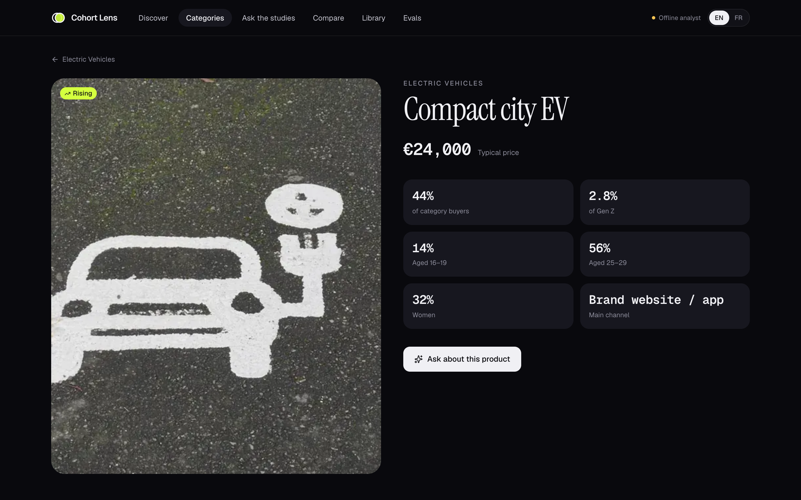
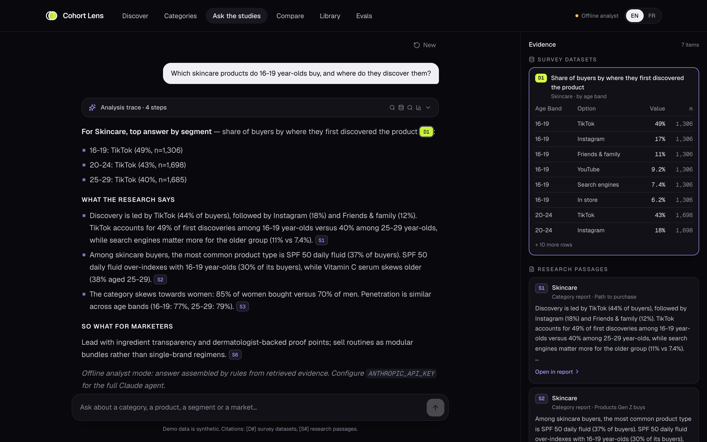
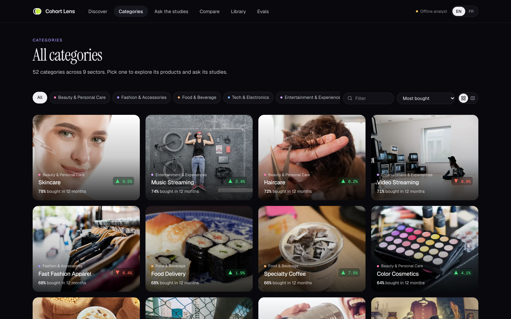
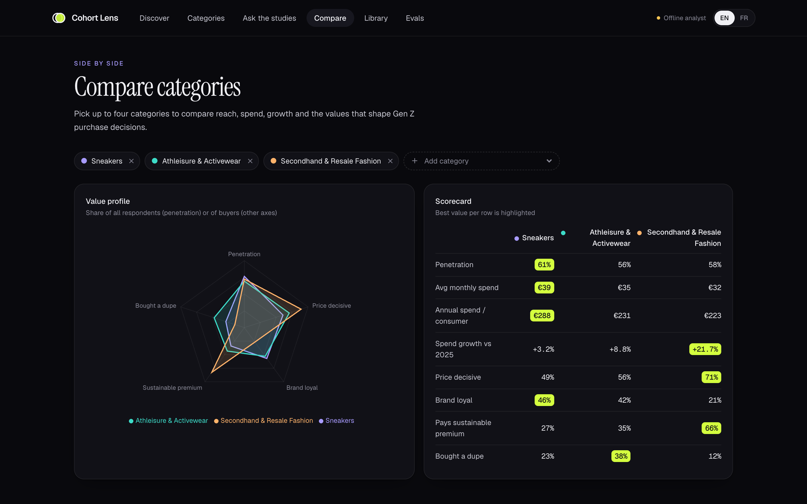
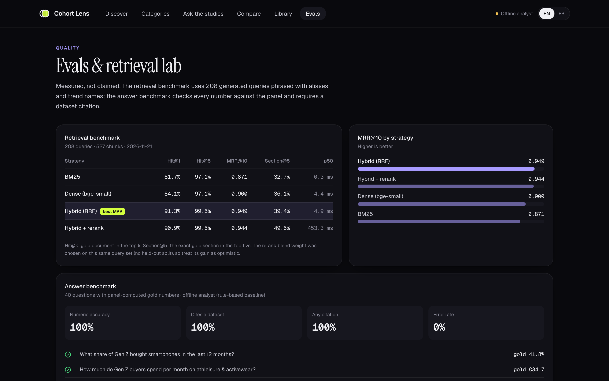
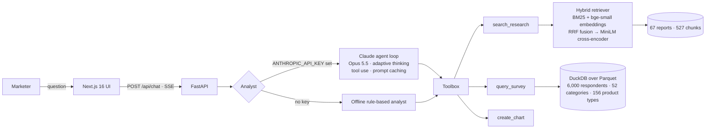

<div align="center">

# Cohort Lens

**Browse what Gen Z buys. Ask the studies why.**
A storefront-style research platform over 52 product categories (beauty to cars) and 156 product types, with an agentic RAG analyst that answers from 67 research reports and a 6,000-respondent panel, every number cited to its source. English and French.

Claude Opus 5.5 · FastAPI · DuckDB · Hybrid retrieval (BM25 + embeddings + cross-encoder) · Next.js 16 · Measured with an eval harness



</div>

---

## Why this project

Marketing teams sit on stacks of market studies and survey data, yet simple questions still need an analyst: *"Where do 16-19 year-olds discover skincare, and how is that different for 25-29?"* Plain RAG over PDFs is not enough here. It paraphrases numbers, mixes up segments and gives no way to check an answer.

Cohort Lens treats the two kinds of evidence differently:

| Evidence | Tool | Why |
|---|---|---|
| Qualitative research (reports, trends, recommendations) | `search_research`: hybrid retrieval over section-aware chunks | Context and explanations are best found semantically |
| Quantitative survey data (penetration, spend, channel mix, by country/age/gender/income) | `query_survey`: typed, parameterised aggregates over respondent-level data | Numbers must be **computed, not retrieved**. The model never writes SQL |

Claude plans the analysis, calls both tools (in parallel when it can), and writes an answer in which every claim carries a citation: `[D1]` for a survey dataset, `[S3]` for a research passage. The UI shows the agent's trace live and links every citation to the exact table or passage.

## Features

- **Storefront home**: search, sector tiles, trending products, fastest-growing categories and a cars & mobility spotlight, all with openly licensed photography.
- **Pick a category, ask its studies**: each category page has a photo hero, its KPIs, the product types Gen Z buys (with photos, prices, trend and share of buyers), analytics tabs, and an **"Ask the studies" panel scoped to that category**.
- **Product pages**: share of category buyers, reach, age and gender profile, main channel, splits by age and market, the research passages that mention the product, and a one-click question to the analyst.
- **Ask the analyst**: streaming chat with a live analysis trace, inline citation chips, generated charts, and an evidence panel with the cited datasets (with base sizes and low-base warnings) and passages (opening the source report at the cited section).
- **Bilingual (EN / FR)**: the whole interface, category and product names, and the analyst's answers switch language; the corpus itself stays in English.
- **Categories**: 52 categories in 9 sectors as a photo grid or an opportunity map (penetration × growth × wallet share), with filters and sorting.
- **Compare**: up to four categories on a radar chart and a scorecard.
- **Research library**: every document the agent can cite, with a reader.
- **Evals & retrieval lab**: benchmark results, plus one query run side by side through BM25, dense, hybrid and hybrid + rerank.
- **Bring your own research**: `python -m app.ingest add report.pdf --category skincare` imports PDF, Markdown, text or HTML into the same pipeline.
- **Runs without an API key**: a deterministic offline analyst uses the same tools and event stream, so the whole product can be demoed and tested offline.

<table>
<tr>
<td></td>
<td></td>
</tr>
<tr>
<td></td>
<td></td>
</tr>
<tr>
<td></td>
<td></td>
</tr>
</table>

## Architecture



**Request flow.** The agent loop (`backend/app/agent.py`) streams Claude's text to the browser while it runs, executes the tool calls locally, assigns stable citation IDs per conversation (`SourceRegistry`), and sends `tool_call`, `source`, `dataset`, `chart`, `text` and `done` events over SSE. Tool inputs are validated with Pydantic before execution, and invalid calls go back to the model as `is_error` tool results so it can correct itself.

**Design decisions**

- **Numbers come from a query engine, not from text.** `query_survey` takes a closed vocabulary (metric, categories, one breakdown, filters) and builds parameterised DuckDB queries. Every result carries `n` and flags bases under 80 respondents.
- **Hybrid retrieval, measured.** BM25 handles exact terms ("dupes", "creatine"). Dense embeddings handle paraphrases ("pre-loved clothing" → resale). Reciprocal Rank Fusion combines them, and an optional cross-encoder reranks the top 20. A pure cross-encoder order lost document recall, so its score is blended with the RRF score (weight 0.3).
- **Contextual chunks.** Chunks follow Markdown sections, and each one is embedded with its document title and section heading, so a passage such as "64% buy on resale apps" stays attributable when it is retrieved alone.
- **A hand-written agent loop on the Messages API.** The tools are local and request-scoped, and every step must stream to the UI, so the loop stays in-process: adaptive thinking, the effort setting, top-level prompt caching, server-side refusal fallbacks (with an automatic retry without them if a deployment rejects the parameter), and typed error handling for rate limits, authentication and connection failures.
- **Grounded by design, honest by default.** The system prompt requires a citation for every number, caveats for low bases, and an explicit "the evidence does not cover this" instead of a guess.

## Evaluation

`make eval` runs two benchmarks and writes `data/eval/report.{json,md}`, which the **Evals** page displays.

**Retrieval**: 208 generated queries written with category *aliases* and trend names (for example *"Where do young consumers usually buy trainers?"*, *"Emerging trends: skin-cycling"*), each with a gold document and section:

| Strategy | Hit@1 | Hit@5 | MRR@10 | Section Hit@5 | p50 latency |
|---|---|---|---|---|---|
| BM25 | 81.7% | 97.1% | 0.871 | 32.7% | 0.3 ms |
| Dense (bge-small-en-v1.5) | 84.1% | 97.1% | 0.900 | 36.1% | 4.4 ms |
| **Hybrid (RRF)** | **91.3%** | **99.5%** | **0.949** | 39.4% | 4.9 ms |
| Hybrid + rerank (blended) | 90.9% | **99.5%** | 0.944 | **49.5%** | 453 ms |

Hybrid fusion adds 7 to 10 points of Hit@1 over either retriever alone. Reranking does not improve document ranking, but it lifts exact-section precision by 10 points, which matters for citation quality. The rerank blend weight was chosen on this same query set (there is no held-out split), so treat that gain as optimistic.

**Answers**: questions whose gold value is computed from the panel (penetration, spend, segment cuts, main channel). An answer passes when it states the gold value (±1) and cites a survey dataset. The committed report comes from the **offline analyst**. It is a pipeline smoke test, not a model score: its rules match the templated questions. Set `ANTHROPIC_API_KEY` and run `make eval` to benchmark the Claude agent (accuracy, citation rate, latency and token usage are recorded per question).

## The data (read this)

The corpus is **synthetic** and is labelled as synthetic everywhere in the product. Real market studies are licensed and cannot be redistributed. So the repository ships a generator that makes the demo internally consistent:

1. `backend/app/corpus/spec.py`: 52 categories with hand-tuned, plausible parameters (penetration, spend, channels, discovery, drivers, values, gender/age skews), plus a qualitative insight and a recommendation for each.
   `backend/app/corpus/catalog.py`: three product types per category (156 in all) with typical prices, trend direction, age skew and French names. Product types are generic (no brands), so no figure is ever attributed to a real company.
2. `backend/app/corpus/survey.py`: simulates 6,000 respondents aged 16-29 in FR/UK/DE/ES/IT/US. The intercepts are calibrated so overall penetration matches the spec, and segments differ through documented effects.
   Each buyer also records the product type they bought most often, so product shares, age profiles and channels are computed, not invented.
3. `backend/app/corpus/reports.py`: writes 52 category reports, 9 sector overviews, 5 thematic reports and a methodology note, **with every figure computed from the simulated panel**. Text and survey queries therefore never disagree, which is what makes the answer benchmark possible.

For real use, import licensed research with the ingestion CLI. Imported documents go through the same chunking, indexing and citation pipeline.

**Photos.** All 208 images (52 category heroes, 156 products) are openly licensed (mostly CC0 from StockSnap and Rawpixel, plus CC BY / CC BY-SA from Flickr and Wikimedia Commons), fetched through the [Openverse](https://openverse.org) API by `backend/scripts/fetch_images.py`, filtered for modern photography without visible brands, reviewed by hand, resized to WebP and served from the repository. Every image is credited in `web/public/img/credits.json` and on the app's **Image credits** page.

## Getting started

Requirements: Python 3.12+ with [uv](https://docs.astral.sh/uv/), Node 22+ with pnpm.

```bash
make install        # backend (uv) + frontend (pnpm)
cp .env.example .env  # optional: add ANTHROPIC_API_KEY for the Claude agent
make dev            # API on :8000, UI on http://localhost:3000
```

The first start downloads the embedding model (~70 MB) and the reranker (~80 MB) and builds the vector index (about 30 s). Later starts load the cached index.

Other commands:

```bash
make test           # 29 backend tests + frontend type-check and lint
make eval           # retrieval + answer benchmarks
make data           # regenerate the synthetic panel, reports and index
make docker         # full stack with Docker Compose
cd backend && uv run python -m app.ingest add path/to/report.pdf --category skincare
```

## Project structure

```
backend/
  app/
    agent.py          Claude tool loop (streaming, validation, fallbacks, errors)
    offline.py        Deterministic analyst with the same tools and events
    tools.py          Tool schemas, input validation, citation registry
    survey.py         Typed DuckDB analytics over the panel
    retrieval/        Section-aware chunking, BM25, dense index, RRF, reranking
    corpus/           Category spec, product catalogue, panel simulator, report generator
    ingest.py         CLI: build / add / index / list
    main.py           FastAPI: chat (SSE), search, survey, categories, documents, eval
  scripts/            Openverse image fetcher and curation passes (with attribution)
  eval/run_eval.py    Retrieval + answer benchmarks
  tests/              Unit, API and agent-loop tests (scripted fake Claude client)
web/                  Next.js 16 (App Router, cache components), Tailwind v4, Recharts, EN/FR i18n
  public/img/         Category and product photos + credits.json
data/                 Synthetic panel (Parquet), corpus (Markdown), eval report
```

## Limitations and next steps

- The answer benchmark for the Claude agent needs an API key and is not committed. An LLM-as-judge faithfulness score is a natural next metric.
- Conversation memory carries only previous answers as text. Earlier tool results are not replayed.
- A natural extension is per-client corpora with authentication, and a hosted vector store for larger libraries.

## License

MIT
